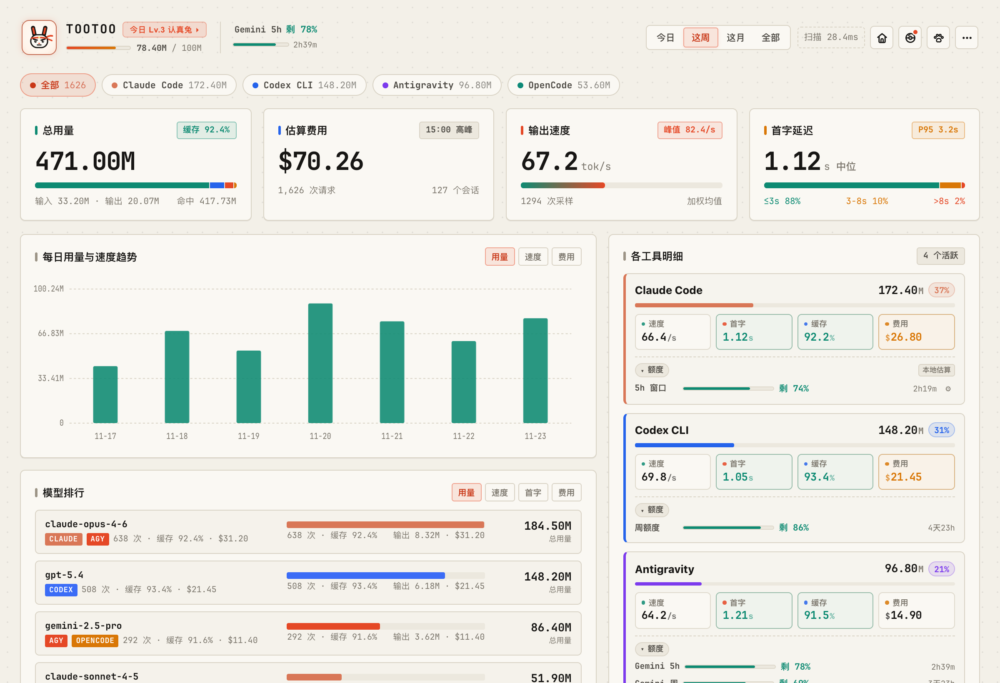
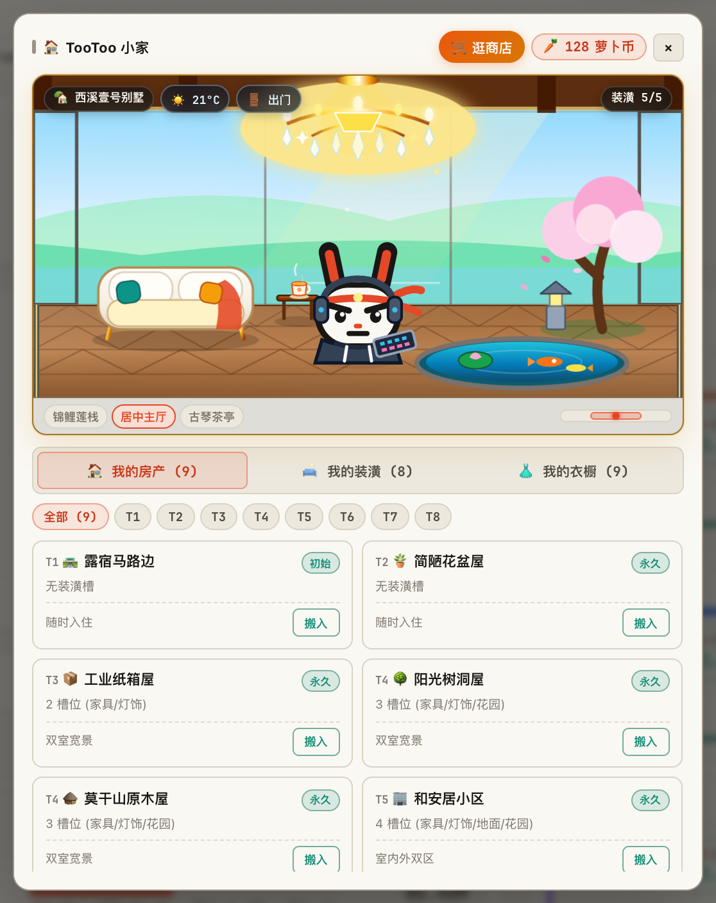
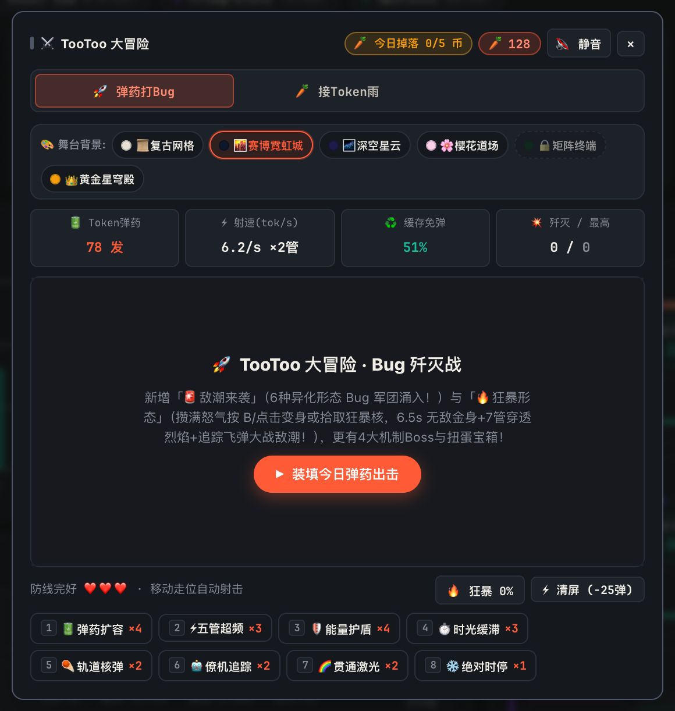

<div align="center">


# TooToo

**零外部依赖的本地 AI 编程遥测控制台 · macOS 原生菜单栏小兔桌宠**

实时追踪 16 款 AI 编程工具的 Token 用量、输出速度（TPS）、首字延迟（TTFT）、缓存命中率、剩余额度与估算费用。<br/>
纯本地只读扫描 · 零代理零侵入 · 写代码养一只会进化的菜单栏小兔。

[-181715?style=flat-square&logo=apple&logoColor=white)](https://github.com/uuuyuqi/tootoo/releases)
[](https://github.com/uuuyuqi/tootoo/releases)
[-0E8A78?style=flat-square)](#架构说明)
[](#支持-16-款本地-ai-编程工具)
[](LICENSE)

```bash
brew install --cask uuuyuqi/tap/tootoo
```

[✨ 核心亮点](#核心亮点) · [📦 安装方式](#安装方式) · [🛠️ 支持工具](#支持-16-款本地-ai-编程工具) · [🏠 写代码养兔兔](#写代码养兔兔可选可一键关闭) · [⌨️ CLI 用法](#cli-与浏览器模式) · [🔒 隐私与性能](#隐私与性能承诺)

</div>

---

<div align="center">
  <picture>
    <source media="(prefers-color-scheme: dark)" srcset="docs/assets/preview-desktop-dark.png" />
    <source media="(prefers-color-scheme: light)" srcset="docs/assets/preview-desktop-light.png" />
    
  </picture>
  <p><sub>精密仪器风双主题控制台（上方预览自动随 GitHub 浅色 / 深色模式切换）· 顶部菜单栏原生弹窗与大屏窗口同步支持</sub></p>
</div>

---

## 核心亮点

| 维度 | 亮点说明 |
| :--- | :--- |
| **🎯 零侵入纯本地只读** | 直接增量扫描本地会话日志与 SQLite，**无需配置 API 代理、无需安装 Hook、零数据上传**。 |
| **⚡ 性能与费用全视角** | 一屏看清 **Token 总量 / 缓存命中率 / 输出速度 (TPS) / 首字延迟 (TTFT P50 & P95) / 估算费用 / 24h 节律 / 工作区排行**。 |
| **📊 实时额度与微缩进度条** | 自动读取 Antigravity、Codex CLI 等实时窗口额度，其余工具支持**本地自定义周期上限**，并可在 macOS 顶部菜单栏底部常驻微缩进度条。 |
| **💰 4 层动态价目引擎** | 本地自定义覆盖 → 原生日志费用校准 → OpenRouter + LiteLLM 2000+ 模型自动同步 → 离线兜底价目表。 |
| **🐰 原生菜单栏进化小兔** | 随今日消耗 Token 自动九阶进化（软萌兔 → 认真兔 → 暴击兔 → 创世飞升兔 + 50B 隐藏形态），顶部菜单栏图标实时同步。 |
| **🧘 内置「简洁模式」** | 喜欢纯粹的数据仪表盘？在右下角 **设置 → 简洁模式** 一键隐藏小家、扭蛋、大冒险与萝卜币，仅保留全部实用统计与轻互动特效。 |

---

## 界面一览

<table>
  <tr>
    <td align="center" width="33%">
      
      <br/><sub><b>macOS 菜单栏弹窗</b><br/>左键即开，右键自定义菜单栏文字与底部额度条</sub>
    </td>
    <td align="center" width="33%">
      
      <br/><sub><b>TooToo 小家（39 套全景宅邸）</b><br/>跨房间镜头跟随、实时本地天气昼夜、百余款装潢穿搭</sub>
    </td>
    <td align="center" width="33%">
      
      <br/><sub><b>算力扭蛋 & 算力炼金</b><br/>写代码换免费萝卜币，2D 物理碰撞胶囊机与限定藏品</sub>
    </td>
  </tr>
</table>

<details>
<summary><b>🎮 展开查看：TooToo 大冒险（弹药打 Bug & 接 Token 雨）</b></summary>
<br/>
<div align="center">
  
  <p><sub>今日消耗的 Token 自动装填为弹药、输出速度化为射速、缓存命中率化为免弹几率，对抗 4 大机制 Boss、敌潮来袭与狂暴形态，或在接 Token 雨中收集冰冻蕉、爆汁石榴与雨水浪潮！</sub></p>
</div>
</details>

---

### ☕ 保持电脑唤醒（macOS）

TooToo 底栏的咖啡杯一键开启防休眠，默认允许屏幕息屏。需要屏幕持续点亮时，可在设置或菜单栏右键菜单里选「屏幕常亮」。可选择不限时、1、2、4 或 8 小时；到期自动关闭。退出或重启 TooToo 后不会继续保持唤醒，但上次选的模式与时长会保留。简洁模式同样可用，浏览器模式不显示此功能。

这只防止空闲休眠，不会阻止合盖、手动休眠或低电量导致的休眠，也不会唤醒已熄灭的屏幕。接电运行长任务时仍建议选定时长。

## 安装方式

### 方式一：Homebrew 一键安装（推荐）

支持 **Apple Silicon (M1–M4)** 与 **Intel Mac**（Universal 通用包），需要 macOS 13 (Ventura) 及以上版本：

```bash
brew install --cask uuuyuqi/tap/tootoo
```

安装完成后：
- 在 `/Applications` 中打开 **TooToo.app**，小兔立即常驻顶部菜单栏；
- 同时自动安装命令行工具 `tootoo`（可直接运行 `tootoo --cli` 查看终端统计）；
- 日后一键更新：

```bash
brew upgrade --cask tootoo
```

### 方式二：下载 GitHub Release 安装包

1. 前往 [**Releases**](https://github.com/uuuyuqi/tootoo/releases) 下载最新版 `TooToo-v0.2.25-macos-universal.zip`。
2. 解压后将 `TooToo.app` 拖入 `/Applications`。
3. 此安装包使用 ad-hoc 签名，未经过 Apple 公证。首次安装或手动替换时，macOS 仍可能提示无法验证开发者。

### 方式三：从源码编译

需要 macOS 13+、Python 3 与 Xcode 命令行工具（`xcode-select --install`）：

```bash
git clone https://github.com/uuuyuqi/tootoo.git
cd tootoo
bash macos/build_app.sh
open /Applications/TooToo.app
```

---

## 支持 16 款本地 AI 编程工具

TooToo 启动后自动发现本机已安装工具的会话记录，零配置开箱即用：

| 工具 | 工具 | 工具 | 工具 |
| :--- | :--- | :--- | :--- |
| **Antigravity (`agy`)** | **Claude Code** | **Codex CLI** | **OpenCode** |
| **Gemini CLI** | **GitHub Copilot CLI** | **Devin CLI** | **Cline / Roo** |
| **Qwen Code** | **Kimi Code** | **MiMoCode** | **Qoder CLI** |
| **Factory Droid** | **Grok CLI** | **Hermes** | **OMP / Pi** |

---

## 写代码养兔兔（可选，可一键关闭）

写代码烧 Token 本身就是一件很有成就感的事——TooToo 把你每天的算力消耗变成了轻量、零氪金的养成反馈：

- **九阶进化 + 50B EX 隐藏形态**：每天按真实 Token 用量进化，高阶自带悬停交互、蓄力元气波、裂空斩、星轨卫星与满 5B 摘星荣誉。
- **TooToo 小家（39 套可互动多房间世界）**：从马路边起步，一路解锁手作双区小屋、山野玻璃花房、城市 LOFT、临水别墅、奇观殿堂、星际太空舱、次元神域直至宇宙皇宫；支持实时天气/昼夜同步、家具装潢与周租/月租抵扣买断。
- **算力扭蛋 & 大冒险**：每消耗 10M Token 或每日签到可领免费萝卜币，玩物理扭蛋机、用今日算力弹药打 Bug（含敌潮来袭 / 狂暴形态 / 4 大机制 Boss）或接 Token 雨。
- **随时回归极简**：点击面板右下角 ⚙ **设置 → 开启「简洁模式」**，立即隐藏全部养成与游戏入口，回归纯粹的高精度遥测仪表盘。

---

### 大冒险券

弹药打 Bug 和接 Token 雨共用票券，每开一局消耗一张。每天首次进入大冒险自动领 3 张；额外可用 5 萝卜币买一张，每天最多买 5 张。每张从领取或购买起有效 7 天，优先消耗先到期的券。

弹药打 Bug 中，狂暴满怒后须手动开启、只持续 3 秒；一次性护盾抵挡一次伤害。每局最多使用两件背包道具，补弹和缓存返弹都有上限。舞台背景名称在解锁后显示。

### 扭蛋与互动舞台

| 来源 | 空包 | N | R | SR | SSR |
| --- | ---: | ---: | ---: | ---: | ---: |
| 算力扭蛋（每抽 1 萝卜币） | 30% | 50% | 15% | 4.5% | 0.5% |
| 大冒险（每个已拾取的神秘宝箱） | 无 | 78.75% | 18% | 3% | 0.25% |

- 月潮观测站、极光王冠、墨龙天印、棱镜时轮、万灯天城是五款新的 SSR 互动舞台。抽中任一款的概率合计为扭蛋 0.10%、宝箱 0.05%；单款分别为 0.02%、0.01%。互动只改变舞台演出，不增加伤害、分数或掉落。
- 老背景单款掉率保持不变，已有背景、当前选择照常保留；黄金星穹殿归入经典 SR 舞台。2 小时和 1 天天气卡分别为 0.5% 和 0.1%（两种来源相同）。
- 图鉴中曾解锁、但今天还没到的等级会置灰，仍能查看、触发动效和选用饰品，不会重新上锁。

### 额度来源

- Codex 优先保留本地日志已有的有效额度。近期使用过且日志没有可用额度时，macOS 应用才会从标准 Homebrew 位置启动 Codex，后台只向当前 Codex CLI 账号读取额度，不合并不同来源的窗口。
- Codex 和 AGY 都默认按条件自动读取；设置仅显示来源，不重复显示额度列表。旧版明确保存的 AGY 关闭状态会保留。管理员可为应用进程设置 `TOOTOO_AGY_CLI=off` 或 `TOOTOO_CODEX_QUOTA_AUTO=off`，禁用新的后台读取。

### v0.2.25 更新

- 摇完后扭蛋胶囊落成不整齐的一堆：每颗停在领圈或另一颗胶囊上，间距不齐、倾角各不相同，不再浮空，也不再排成两行整齐格子。

### v0.2.24 更新

- 修复扭蛋机摇完不落球：普通奖和空包都会先落下，再显示结果。中途关闭弹窗不会重播动画或重复扣币。开启「减少动态效果」时直接显示落地结果。

### v0.2.23 更新

- Factory Droid 卡片显示所选日期范围内的本地已耗积分。仅从 `~/.factory/sessions` 的会话设置读取 `tokenUsage.factoryCredits`；不读取 Cookie 或凭证，也不查询 Factory 云端。沿用现有 Droid 统计方式，累计会话数据归到文件最近修改时间，不是逐笔扣费记录。
- 可手动设置 5 小时、24 小时、7 天或 30 天的滚动积分预算。未设上限时只显示已耗积分，不显示套餐剩余额度。积分不计入全局 Token、估算费用或游戏进度。

### v0.2.22 更新

- 重新平衡弹药打 Bug：后期敌人更多、更耐打；降低补弹和缓存返弹，狂暴只能手动释放且不能续时，护盾一次性。
- 大冒险两款游戏共用票券：每局 1 张；每天首次进入领 3 张、5 萝卜币可买 1 张、每天最多买 5 张。单张有效期 7 天。
- 未解锁的舞台背景隐藏名字、图标与配色。

### v0.2.21 更新

- 弹窗顶栏将 Gemini 周额度简写为 Gemini，保留剩余比例和重置时间，兔子等级和箭头不再被挤到两行。
- Antigravity 额度卡片统一对齐模型名、周期和剩余比例。

### v0.2.20 更新

- 兑换、签到与巡逻领币后，胡萝卜飞入钱包，余额逐次增加；macOS 兼容触摸板同步提供触觉反馈。余额先保存，关窗或消费时立即显示实际余额。
- 开启系统「减少动态效果」时不播放飞行和弹跳，直接显示结果，仅触发一次触觉反馈。

### v0.2.19 更新

- 各工具明细按 Token 用量从高到低展示；Grok Bot 卡片放在末尾，仍可从顶栏快速定位。

### v0.2.18 更新

- 修复 Grok Bot 账号文件名包含 URL 编码时无法读取周额度与活跃度的问题。
- Codex 历史压缩归档在后台分批加载，近期数据先显示；历史归档独立缓存，新增日志不再重写历史缓存。

### v0.2.17 更新

- macOS 新增 Grok Bot 周额度和会话活跃度。只从本机读取额度缓存和消息元数据；不读取凭证，不提取对话正文，不计入 Token、费用或模型排行。过期额度显示待刷新。可钉选到顶部和菜单栏。
- Codex 可扫描普通与 Zstandard 压缩会话日志（有标准库解压能力、可选 Python 模块或本机 `zstd` 时）；修正推理 Token 重复计数，并补记日志中可核实、未被累计值覆盖的上下文压缩用量。
- 进化图鉴用浅灰徽章显示曾解锁但今日未达到的形态，保留头像细节、饰品和互动。

### v0.2.16 更新

- 大冒险新增五款 SSR 互动舞台，可用鼠标点击触发效果；保留旧舞台和收藏。
- 下调扭蛋和神秘宝箱稀有奖励的概率；扭蛋仍是 30% 空包，宝箱仍必出奖励。
- 进化图鉴中曾解锁、当天未达到的形态置灰，不会重新上锁。

### v0.2.15 更新

- Codex 与 Antigravity 额度刷新时保留上次有效读数，成功后主动推送；首次查询会显示「读取中…」。
- 菜单栏短暂读数失败不再归零，兔子等级与今日经验包一致，真实 Token 数值不变。右键立即刷新会触发后台刷新，检查更新会在完整窗口就绪后打开。
- 安装包清除资源叉，避免更新器拒绝归档。

### v0.2.14 更新

- Antigravity CLI 额度刷新时保留上次有效读数；重启可先显示缓存，新的读数到达后会立即更新。首次尚无快照时显示「读取中…」，关闭后台读取后不会显示该缓存。

### v0.2.13 更新

- 今日获得算力经验包时，顶部显示经验包增量，悬停可查看真实 Token 与加成；进化图鉴也会说明加成来源。窄版面板为额度栏保留空间，真实用量和已解锁形态不受影响。
- 修复扭蛋结果出现后，顶部两颗球仍不停转动的问题。

### v0.2.12 更新

- 修复扭蛋和宝箱的算力经验包升阶后，图鉴及相关等级奖励仍锁定的问题。经验包当日生效，已解锁形态不会在次日重新上锁；真实用量统计不受影响。

### v0.2.11 更新

- 识别 npm 全局安装的 Codex，直接读取对应架构的原生程序，不执行外层脚本；保留 Homebrew 支持。
- AGY 返回 Claude/GPT 5 小时和周窗口满额、未开始计时时，保留 100% 显示，不显示重置倒计时。
- 顶部额度固定选择某项后不再自动换成其他来源；仅「自动选择」模式会切换。存在独立额度时显示「Gemini 4 Argon 周额度」。

### v0.2.10 更新

- Codex 本地日志没有可用额度时，后台通过官方 Codex App Server 读取当前 CLI 账号的剩余额度。已有可用日志仍然优先。
- 对齐 AGY 额度卡片的进度条、剩余百分比和重置时间。设置只保留来源说明，不再显示自动读取开关或重复的额度列表。

### v0.2.9 更新

- 近期使用过 Antigravity 时，TooToo 在后台用新版 AGY CLI 的官方 `/usage` 查询剩余额度，并分开显示 Gemini、Claude/GPT 和 Argon（若有返回）。详细额度显示在工具卡片；在「设置 → 额度来源」可查看当前来源。
- 新方式要求 AGY CLI 1.1.11 以上的 1.x 版本、默认安装位置以及允许斜杠命令的现有设置。TooToo 不读取登录凭据、不修改 AGY 设置，保留旧版桌面读取方式。

### v0.2.8 更新

- 修复菜单栏面板快速收起再打开时，过期的关闭回调把当前游戏卡在暂停状态的问题。
- 「打 Bug」暂停时仍可主动结束并正常结算；重新互动时可恢复可见面板里的游戏。

### v0.2.7 更新

- 「打 Bug」和「接 Token 雨」都可主动结束并查看战报。打 Bug 的敌潮每波提供一份补给，减少重复强化和补弹；Token 雨的强力掉落也更有节奏。
- 有新版本时，设置齿轮显示小圆点；仍可在「设置 → 软件更新」里检查、下载与安装。

### v0.2.6 更新

- 菜单栏面板收起时暂停「打 Bug」和「接 Token 雨」，重新打开可继续同一局；主动关闭游戏或切换玩法会恢复开始界面。
- 修复音效已开启但音频被系统打断后不能恢复的问题，音效开关仍保留原有设置。

### v0.2.5 更新

- 算力扭蛋机新增 30% 的空包结果：仍消耗 1 枚萝卜币但不发奖励；其余概率为 N 40%、R 20%、SR 8%、SSR 2%。游戏中捡到的神秘扭蛋不变。
- 在线价目同步过滤 OpenRouter 的特殊后缀条目，优先保留实际模型对应的 LiteLLM 价目；旧缓存会自动刷新。


### 软件更新（macOS）

从 v0.2.4 起，可在「设置 → 软件更新」或菜单栏右键菜单检查；简洁模式仍会提示新版本。正式版可确认后下载、校验并重启更新，设置和存档不会被改动。调试版和纯浏览器只能查看和打开发布页；安装位置不允许替换时也请手动下载。

v0.2.3 及更早版本没有应用内更新入口，请先通过 Homebrew 或 Release 下载升级。应用内更新不修改 Homebrew 的安装记录；希望由 Homebrew 统一管理时，继续使用 `brew upgrade --cask tootoo`。

### 本地开发调试（macOS）

执行 `bash macos/run_debug.sh` 启动隔离的 `TooToo-Debug.app`，可以与 Homebrew 正式版同时运行。用 `NO_INSTALL=1 bash macos/run_debug.sh` 从 `dist/` 运行，不安装到「应用程序」。调试版默认使用 `~/.tootoo-debug`，正式版仍使用 `~/.tootoo`；可按需设置非空的 `TOOTOO_HOME` 为其他独立目录。两个版本仍读取同一套 AI 工具原始日志。

## CLI 与浏览器模式

不想用菜单栏 App？也可以直接在终端或任意浏览器使用：

```bash
# 启动本地 Web 控制台（默认 http://127.0.0.1:7891）
tootoo

# 终端快速查看今日 / 近 7 天统计
tootoo --cli --range today
tootoo --cli --range week --tool codex

# 输出原始 JSON（方便接入自定义脚本 / Raycast / SketchyBar）
tootoo --json --range today

# 手动同步最新远程模型价目表
tootoo --refresh-pricing
```

---

## 隐私与性能承诺

- **100% 本地只读**：仅扫描本机 AI 工具日志目录，绝不读取你的源代码内容、绝不上报任何遥测数据；唯一可选外网请求为拉取开源模型公开价目表（OpenRouter / LiteLLM）与本地天气（`wttr.in`）。
- **极致低耗**：增量缓存（`~/.tootoo/scan_cache_v6.json` 与独立 Codex 历史归档缓存）+ 弹窗收起后自动暂停前端动画与断开 SSE 连接，后台常驻近 **0.0% CPU** 占用。
- **自定义模型单价**：可在 `~/.tootoo/pricing_overrides.json` 按模型自定义输入/输出/缓存单价，实时生效。

---

## 架构说明

```text
tootoo/
├── scanner.py             # 16 款工具本地日志 / SQLite 增量扫描引擎
├── pricing.py             # 4 层动态费用估算与 OpenRouter / LiteLLM 同步
├── server.py              # 零依赖 Python 3 本地 HTTP + SSE 服务与 CLI
├── tootoo                 # CLI 启动脚本（支持软链调用）
├── ui/
│   ├── index.html         # 精密仪器风双主题控制台与小游戏引擎
│   ├── tootoo_catalog.js  # 房型 / 装潢 / 穿搭 / 节日与经济系统注册表
│   ├── tootoo_art_*.js    # 39 套场景与百余件装潢穿搭矢量美术
│   ├── tootoo_world_engine.js  # 多房间镜头跟随、寻路与场景机关引擎
│   └── bunny_lines.json   # 小兔互动语料库
└── macos/
    ├── main.swift         # 原生 Swift 菜单栏常驻 App + WKWebView Popover
    ├── gen_icon.swift     # 矢量生成 App 图标
    └── build_app.sh       # Universal (arm64 + x86_64) 打包脚本（默认裁剪调试代码）
```

## License

[Apache License 2.0](LICENSE) © 2026 [uuuyuqi](https://github.com/uuuyuqi)
