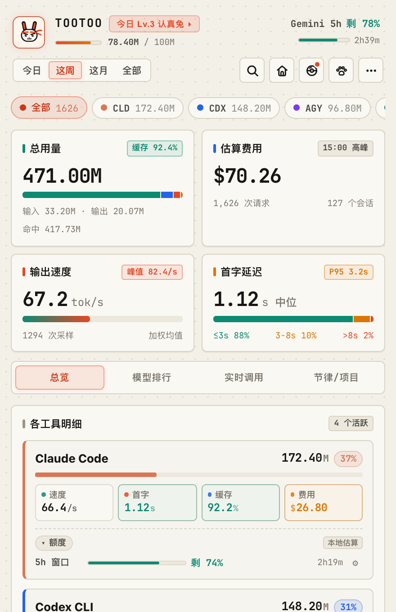
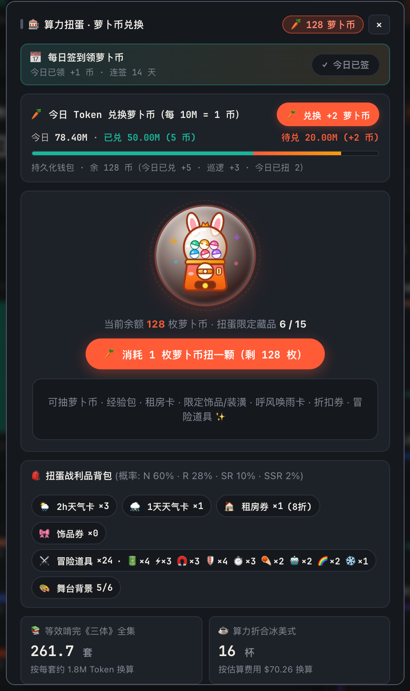

<div align="center">


# TooToo

**零外部依赖的本地 AI 编程遥测控制台 · macOS 原生菜单栏小兔桌宠**

实时追踪 16 款 AI 编程工具的 Token 用量、输出速度（TPS）、首字延迟（TTFT）、缓存命中率、剩余额度与估算费用。<br/>
纯本地只读扫描 · 零代理零侵入 · 写代码养一只会进化的菜单栏小兔。

[-181715?style=flat-square&logo=apple&logoColor=white)](https://github.com/uuuyuqi/tootoo/releases)
[](https://github.com/uuuyuqi/tootoo/releases)
[-0E8A78?style=flat-square)](#架构说明)
[](#支持-16-款本地-ai-编程工具)
[](LICENSE)

```bash
brew install --cask uuuyuqi/tap/tootoo
```

[✨ 核心亮点](#核心亮点) · [📦 安装方式](#安装方式) · [🛠️ 支持工具](#支持-16-款本地-ai-编程工具) · [🏠 写代码养兔兔](#写代码养兔兔可选可一键关闭) · [⌨️ CLI 用法](#cli-与浏览器模式) · [🔒 隐私与性能](#隐私与性能承诺)

</div>

---

<div align="center">
  <picture>
    <source media="(prefers-color-scheme: dark)" srcset="docs/assets/preview-desktop-dark.png" />
    <source media="(prefers-color-scheme: light)" srcset="docs/assets/preview-desktop-light.png" />
    
  </picture>
  <p><sub>精密仪器风双主题控制台（上方预览自动随 GitHub 浅色 / 深色模式切换）· 顶部菜单栏原生弹窗与大屏窗口同步支持</sub></p>
</div>

---

## 核心亮点

| 维度 | 亮点说明 |
| :--- | :--- |
| **🎯 零侵入纯本地只读** | 直接增量扫描本地会话日志与 SQLite，**无需配置 API 代理、无需安装 Hook、零数据上传**。 |
| **⚡ 性能与费用全视角** | 一屏看清 **Token 总量 / 缓存命中率 / 输出速度 (TPS) / 首字延迟 (TTFT P50 & P95) / 估算费用 / 24h 节律 / 工作区排行**。 |
| **📊 实时额度与微缩进度条** | 自动读取 Antigravity、Codex CLI 等实时窗口额度，其余工具支持**本地自定义周期上限**，并可在 macOS 顶部菜单栏底部常驻微缩进度条。 |
| **💰 4 层动态价目引擎** | 本地自定义覆盖 → 原生日志费用校准 → OpenRouter + LiteLLM 2000+ 模型自动同步 → 离线兜底价目表。 |
| **🐰 原生菜单栏进化小兔** | 随今日消耗 Token 自动九阶进化（软萌兔 → 认真兔 → 暴击兔 → 创世飞升兔 + 50B 隐藏形态），顶部菜单栏图标实时同步。 |
| **🧘 内置「简洁模式」** | 喜欢纯粹的数据仪表盘？在右下角 **设置 → 简洁模式** 一键隐藏小家、扭蛋、大冒险与萝卜币，仅保留全部实用统计与轻互动特效。 |

---

## 界面一览

<table>
  <tr>
    <td align="center" width="33%">
      
      <br/><sub><b>macOS 菜单栏弹窗</b><br/>左键即开，右键自定义菜单栏文字与底部额度条</sub>
    </td>
    <td align="center" width="33%">
      
      <br/><sub><b>TooToo 小家（39 套全景宅邸）</b><br/>跨房间镜头跟随、实时本地天气昼夜、百余款装潢穿搭</sub>
    </td>
    <td align="center" width="33%">
      
      <br/><sub><b>算力扭蛋 & 算力炼金</b><br/>写代码换免费萝卜币，2D 物理碰撞胶囊机与限定藏品</sub>
    </td>
  </tr>
</table>

<details>
<summary><b>🎮 展开查看：TooToo 大冒险（弹药打 Bug & 接 Token 雨）</b></summary>
<br/>
<div align="center">
  
  <p><sub>今日消耗的 Token 自动装填为弹药、输出速度化为射速、缓存命中率化为免弹几率，对抗 4 大机制 Boss、敌潮来袭与狂暴形态，或在接 Token 雨中收集冰冻蕉、爆汁石榴与雨水浪潮！</sub></p>
</div>
</details>

---

## 安装方式

### 方式一：Homebrew 一键安装（推荐）

支持 **Apple Silicon (M1–M4)** 与 **Intel Mac**（Universal 通用包），需要 macOS 13 (Ventura) 及以上版本：

```bash
brew install --cask uuuyuqi/tap/tootoo
```

安装完成后：
- 在 `/Applications` 中打开 **TooToo.app**，小兔立即常驻顶部菜单栏；
- 同时自动安装命令行工具 `tootoo`（可直接运行 `tootoo --cli` 查看终端统计）；
- 日后一键更新：

```bash
brew upgrade --cask tootoo
```

### 方式二：下载 GitHub Release 安装包

1. 前往 [**Releases**](https://github.com/uuuyuqi/tootoo/releases) 下载最新版 `TooToo-v0.2.0-macos-universal.zip`。
2. 解压后将 `TooToo.app` 拖入 `/Applications`。
3. 首次打开若遇 macOS 未知开发者提示（开源项目使用 ad-hoc 本地签名），在终端执行一次即可：
   ```bash
   xattr -cr /Applications/TooToo.app
   open /Applications/TooToo.app
   ```

### 方式三：从源码编译

需要 macOS 13+、Python 3 与 Xcode 命令行工具（`xcode-select --install`）：

```bash
git clone https://github.com/uuuyuqi/tootoo.git
cd tootoo
bash macos/build_app.sh
open /Applications/TooToo.app
```

---

## 支持 16 款本地 AI 编程工具

TooToo 启动后自动发现本机已安装工具的会话记录，零配置开箱即用：

| 工具 | 工具 | 工具 | 工具 |
| :--- | :--- | :--- | :--- |
| **Antigravity (`agy`)** | **Claude Code** | **Codex CLI** | **OpenCode** |
| **Gemini CLI** | **GitHub Copilot CLI** | **Devin CLI** | **Cline / Roo** |
| **Qwen Code** | **Kimi Code** | **MiMoCode** | **Qoder CLI** |
| **Factory Droid** | **Grok CLI** | **Hermes** | **OMP / Pi** |

---

## 写代码养兔兔（可选，可一键关闭）

写代码烧 Token 本身就是一件很有成就感的事——TooToo 把你每天的算力消耗变成了轻量、零氪金的养成反馈：

- **九阶进化 + 50B EX 隐藏形态**：每天按真实 Token 用量进化，高阶自带悬停交互、蓄力元气波、裂空斩、星轨卫星与满 5B 摘星荣誉。
- **TooToo 小家（39 套可互动多房间世界）**：从马路边起步，一路解锁手作双区小屋、山野玻璃花房、城市 LOFT、临水别墅、奇观殿堂、星际太空舱、次元神域直至宇宙皇宫；支持实时天气/昼夜同步、家具装潢与周租/月租抵扣买断。
- **算力扭蛋 & 大冒险**：每消耗 10M Token 或每日签到可领免费萝卜币，玩物理扭蛋机、用今日算力弹药打 Bug（含敌潮来袭 / 狂暴形态 / 4 大机制 Boss）或接 Token 雨。
- **随时回归极简**：点击面板右下角 ⚙ **设置 → 开启「简洁模式」**，立即隐藏全部养成与游戏入口，回归纯粹的高精度遥测仪表盘。

---

## CLI 与浏览器模式

不想用菜单栏 App？也可以直接在终端或任意浏览器使用：

```bash
# 启动本地 Web 控制台（默认 http://127.0.0.1:7891）
tootoo

# 终端快速查看今日 / 近 7 天统计
tootoo --cli --range today
tootoo --cli --range week --tool codex

# 输出原始 JSON（方便接入自定义脚本 / Raycast / SketchyBar）
tootoo --json --range today

# 手动同步最新远程模型价目表
tootoo --refresh-pricing
```

---

## 隐私与性能承诺

- **100% 本地只读**：仅扫描本机 AI 工具日志目录，绝不读取你的源代码内容、绝不上报任何遥测数据；唯一可选外网请求为拉取开源模型公开价目表（OpenRouter / LiteLLM）与本地天气（`wttr.in`）。
- **极致低耗**：增量缓存（`~/.tootoo/scan_cache_v5.json`）+ 弹窗收起后自动暂停前端动画与断开 SSE 连接，后台常驻近 **0.0% CPU** 占用。
- **自定义模型单价**：可在 `~/.tootoo/pricing_overrides.json` 按模型自定义输入/输出/缓存单价，实时生效。

---

## 架构说明

```text
tootoo/
├── scanner.py             # 16 款工具本地日志 / SQLite 增量扫描引擎
├── pricing.py             # 4 层动态费用估算与 OpenRouter / LiteLLM 同步
├── server.py              # 零依赖 Python 3 本地 HTTP + SSE 服务与 CLI
├── tootoo                 # CLI 启动脚本（支持软链调用）
├── ui/
│   ├── index.html         # 精密仪器风双主题控制台与小游戏引擎
│   ├── tootoo_catalog.js  # 房型 / 装潢 / 穿搭 / 节日与经济系统注册表
│   ├── tootoo_art_*.js    # 39 套场景与百余件装潢穿搭矢量美术
│   ├── tootoo_world_engine.js  # 多房间镜头跟随、寻路与场景机关引擎
│   └── bunny_lines.json   # 小兔互动语料库
└── macos/
    ├── main.swift         # 原生 Swift 菜单栏常驻 App + WKWebView Popover
    ├── gen_icon.swift     # 矢量生成 App 图标
    └── build_app.sh       # Universal (arm64 + x86_64) 打包脚本（默认裁剪调试代码）
```

## License

[Apache License 2.0](LICENSE) © 2026 [uuuyuqi](https://github.com/uuuyuqi)
